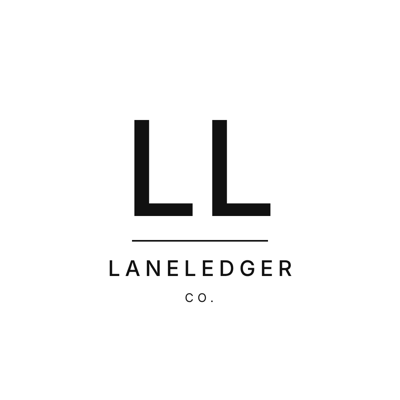
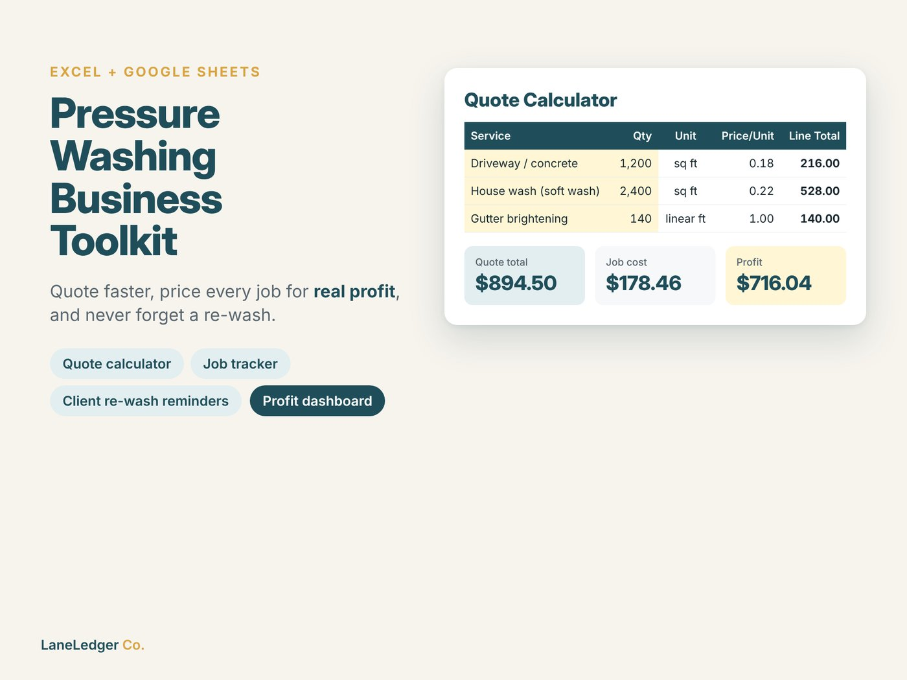

# LaneLedger Co. – Spreadsheet Tools for Small Businesses

LaneLedger Co. is a small digital-products business I started in October 2026. It sells ready-to-use Excel / Google Sheets tools for small online sellers and service businesses on [Etsy](https://www.etsy.com/shop/LaneLedgerCo).

## Products

| | Product | Etsy | Repo & free demo |
|---|---|---|---|
|  | **Pressure Washing Business Toolkit** Quote calculator with real job cost & profit, jobs pipeline, client CRM with re-wash reminders, expenses and dashboard | [View listing](https://www.etsy.com/listing/4602384022/pressure-washing-business-spreadsheet) | [pressure-washing-business-toolkit](https://github.com/EkremHakanSevil/pressure-washing-business-toolkit) |
|  | **Seller Profit Tracker** Real profit after platform fees, break-even and target-margin pricing, sales log and yearly dashboard | [View listing](https://www.etsy.com/listing/4602364714/seller-profit-tracker-spreadsheet-etsy) | [seller-profit-tracker](https://github.com/EkremHakanSevil/seller-profit-tracker) |

## What I did

| Area | Details |
|---|---|
| Market research | Platform choice (Etsy vs. Shopier), keyword demand vs. competition analysis to find underserved niches |
| Product development | Workbooks generated with Python + `openpyxl` (styling, validation, conditional formatting, charts, thousands of formulas), tested with headless LibreOffice |
| Design & branding | Logo, shop banner and listing images (HTML/CSS rendered with Playwright) |
| Launch | Etsy shop setup, listing copy and SEO tags, pricing, AI-use disclosure, free demos for marketing |

**AI-assisted:** This business was built in collaboration with Anthropic's Claude. I directed the business decisions, reviewed and tested every product and ran the shop; Claude helped with research, code generation, design and copywriting.

## Status
- Shop opened: October 2026
- Live products: 2 (each with a free demo)
- Next: more niche business tools based on keyword research
