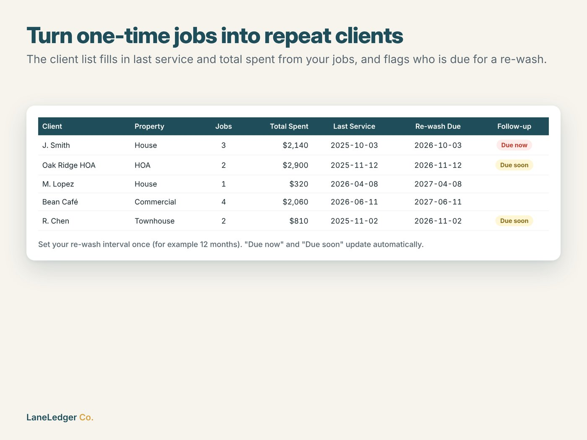
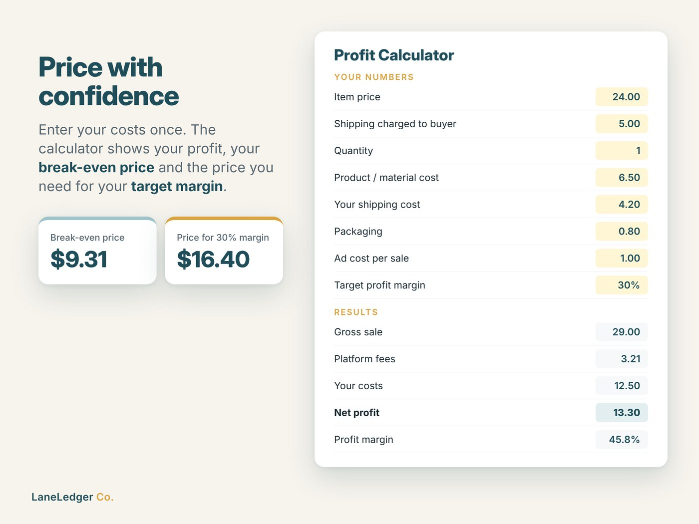
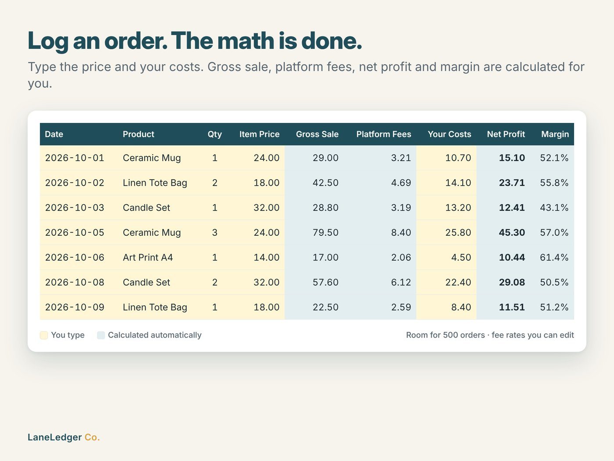

# LaneLedger Co. – Spreadsheet Tools for Small Businesses

LaneLedger Co. is a small digital-products business I started in October 2026. It sells ready-to-use Excel / Google Sheets tools for small online sellers and service businesses on [Etsy](https://www.etsy.com/shop/LaneLedgerCo).

This repository is a **portfolio showcase** of the products and how they were built. The paid product files are not included.

---

## Products

### 1. Pressure Washing Business Toolkit
An 8-tab workbook for pressure washing / soft washing businesses.

- **Quote Calculator** – services, quantities and distance in; customer price out, with minimum charges, travel fee beyond a free radius, discount, tax, deposit, and a copy-ready quote message
- **Internal cost & profit** – estimated work time from per-service production rates, labor, chemical, fuel and equipment cost, profit, margin, effective hourly rate, and a warning when a quote falls below the target margin
- **Jobs Log** – job pipeline (Quoted → Booked → Done → Paid / Lost), lead source, profit per job, conditional formatting for unpaid work
- **Clients (CRM)** – jobs, total spent and last service pulled from the Jobs Log, plus automatic "Due now / Due soon" re-wash reminders
- **Dashboard** – monthly revenue, job costs, expenses and net profit, quote win rate, unpaid jobs and revenue by lead source

| Quote & profit | Jobs pipeline | Re-wash reminders |
|---|---|---|
|  |  |  |

### 2. Seller Profit Tracker
A 6-tab workbook that shows online sellers their real profit after platform fees.

- Sales log with automatic platform fee, net profit and margin per order
- Editable fee settings (listing, transaction, payment processing, currency conversion)
- Profit calculator with break-even price and price for a target margin
- Yearly dashboard by month with chart and expenses by category

| Dashboard | Profit calculator | Sales log |
|---|---|---|
|  |  |  |

---

## How it was built

| Area | Details |
|---|---|
| Market research | Keyword demand vs. competition analysis to pick an underserved niche (pressure washing tools: high search volume, few competing listings) |
| Workbook generation | Python + `openpyxl`: workbooks are generated from code, including styling, data validation dropdowns, conditional formatting, charts and ~3,700 formulas |
| Formula design | Excel-2007-compatible functions (`SUMIFS`, `COUNTIFS`, `INDEX/MATCH`, `MAXIFS`, `EDATE`) so the same file works in Excel and Google Sheets |
| Testing | Headless LibreOffice recalculation to verify zero formula errors, plus hand-checked test cases for every calculation (fees, break-even, quote totals, travel fees) |
| Listing images | HTML/CSS templates rendered to 2000×1500 images with Playwright |
| Branding & launch | Logo, shop banner, listing copy and SEO tags; shop setup and listing publication on Etsy |

**AI-assisted:** This project was built in collaboration with Anthropic's Claude. I directed the business decisions (platform, niche, pricing, branding), reviewed and tested every product, and ran the shop setup; Claude helped with research, code generation, design and copywriting. Etsy listings disclose AI use as required by Etsy's Creativity Standards.

---

## Status
- Shop opened: October 2026
- Live products: 2
- Next: more niche business tools based on keyword research

*This repository contains screenshots and documentation only. The workbook files are sold on Etsy.*
